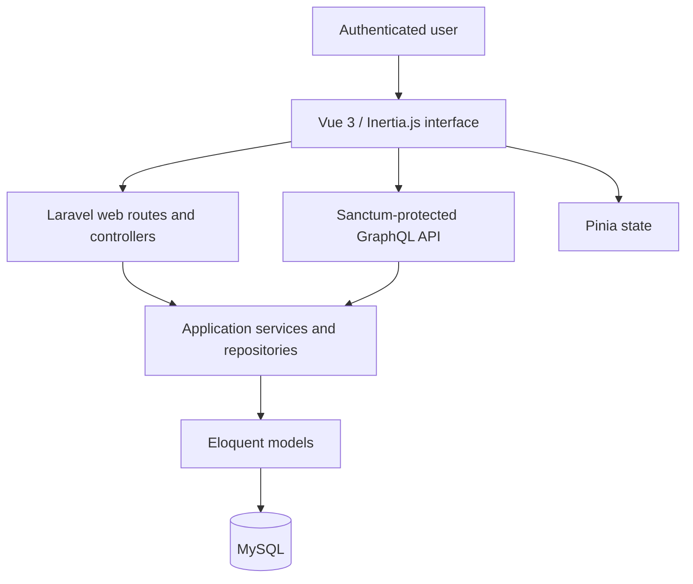

# Task Manager

[](https://github.com/josiahking/taskmanager/actions/workflows/tests.yml)
[](https://github.com/josiahking/taskmanager/actions/workflows/lint.yml)

A full-stack task and project management application built with Laravel, Inertia.js, Vue 3, Pinia, GraphQL, and Laravel Sanctum.

The application supports authenticated project and task workflows, task prioritisation and ordering, GraphQL queries and mutations, personal access tokens, automated tests, and continuous integration.

## Engineering highlights

Task Manager demonstrates the design and delivery of a **full-stack Laravel application** with a Vue-powered interface, authenticated APIs, and automated quality checks. It combines conventional web workflows with GraphQL rather than relying on a single API style.

- **Full-stack architecture:** Laravel 12 handles backend workflows, while Inertia.js, Vue 3, and TypeScript deliver the application interface.
- **Separated responsibilities:** Controllers, services, repositories, Eloquent models, GraphQL resolvers, and frontend stores have distinct roles in the codebase.
- **Authenticated API access:** Laravel Sanctum protects the GraphQL endpoint, while Laravel Breeze and email verification secure web application routes.
- **Project and task workflows:** Users can manage projects, create and prioritize tasks, reorder them, and link or unlink tasks from projects.
- **Frontend state management:** Pinia supports client-side application state alongside server-driven Inertia pages.
- **Test and quality tooling:** Pest/PHPUnit and Vitest cover backend and frontend behavior; GitHub Actions runs test and code-quality workflows, supported by Pint, ESLint, and Prettier.
- **Reproducible development:** Laravel Sail and Docker support local setup with MySQL.

### Application flow



**What this project demonstrates:** The ability to structure an end-to-end Laravel/Vue product, secure multiple access paths, organize application concerns, and maintain backend and frontend quality checks. See the [architecture](#architecture), [GraphQL API](#graphql-api), and [testing](#testing) sections for implementation details.

## Live Demo

[Open the Task Manager demo](https://josiah-taskmanager.nue.dom.my.id/)

> The demo is hosted on a free DOM Cloud subdomain, which may display a third-party safety notice before opening the application.

## Features

### Project Management

- Create, view, update, and delete projects
- Organise tasks under projects
- Retrieve project-specific task data
- Query projects through GraphQL

### Task Management

- Create, view, update, and delete tasks
- Assign tasks to projects
- Set task priorities
- Reorder tasks
- Group tasks by project
- Remove a task from its associated project
- Query tasks through GraphQL

### Authentication and User Access

- Laravel Breeze authentication
- Email-verified application routes
- Laravel Sanctum personal access tokens
- Authenticated GraphQL endpoint
- User profile management
- Protected GraphiQL interface

### Engineering Quality

- Pest and PHPUnit backend tests
- Vitest frontend tests
- Laravel Pint formatting
- ESLint and Prettier
- GitHub Actions for tests and code quality
- Docker development with Laravel Sail

## Technology Stack

### Backend

- PHP 8.2+
- Laravel 12
- Laravel Sanctum
- Inertia Laravel
- Rebing GraphQL for Laravel
- Ziggy
- Pest 4
- PHPUnit
- Laravel Pint

### Frontend

- Vue 3
- Inertia.js
- TypeScript
- Pinia
- Pinia persisted state
- Vite
- Axios
- VueUse
- Vue Draggable
- Tailwind CSS
- Heroicons
- Vue Toastification
- Vitest
- Vue Test Utils
- ESLint
- Prettier

### Development and Infrastructure

- Laravel Sail
- Docker
- MySQL 8
- Mailpit
- GitHub Actions

## Architecture

Task Manager uses Laravel and Inertia.js as a server-driven single-page application.

```text
taskmanager/
├── app/
│   ├── GraphQL/          # GraphQL queries, mutations, and types
│   ├── Http/             # Controllers, middleware, and requests
│   ├── Models/           # Eloquent models
│   ├── Repositories/     # Data-access logic
│   └── Services/         # Application service layer
├── database/
│   ├── factories/
│   ├── migrations/
│   └── seeders/
├── resources/
│   └── js/
│       ├── Components/
│       ├── Layouts/
│       ├── Pages/
│       └── stores/
├── routes/
│   ├── web.php
│   ├── api.php
│   └── auth.php
├── tests/
│   ├── Feature/
│   └── Unit/
├── .github/
│   └── workflows/
├── docker/
├── docker-compose.yml
├── composer.json
└── package.json
```

The application separates HTTP controllers, repositories, services, Eloquent models, Inertia pages, Pinia stores, and GraphQL resolvers to keep responsibilities organised.

## Web Routes

Authenticated and email-verified users can access the task-management application.

| Method | Endpoint | Purpose |
|---|---|---|
| `GET` | `/dashboard` | Display the authenticated dashboard |
| `GET` | `/app` | Display the task-manager interface |
| `GET` | `/projects` | Retrieve projects |
| `POST` | `/projects/store` | Create a project |
| `PUT` | `/projects/update` | Update a project |
| `DELETE` | `/projects/delete/{id}` | Delete a project |
| `GET` | `/tasks` | Retrieve tasks |
| `POST` | `/tasks/store` | Create a task |
| `PUT` | `/tasks/update` | Update a task |
| `DELETE` | `/tasks/delete/{id}` | Delete a task |
| `PUT` | `/tasks/unlinkproject` | Remove a task from a project |

Profile routes support profile editing, profile deletion, and Sanctum token generation.

## GraphQL API

The GraphQL endpoint is protected by Laravel Sanctum.

```text
/graphql
```

### Queries

- `users`
- `user`
- `project`
- `projects`
- `task`
- `tasks`

### Mutations

- `createProject`
- `createTask`

GraphQL batching is enabled.

Authenticated users can use the GraphiQL interface at:

```text
/graphiql
```

## Prerequisites

Install the following before running the application:

- PHP 8.2 or later
- Composer
- Node.js and npm
- MySQL 8, or Docker with Laravel Sail
- Git

## Local Installation

### 1. Clone the repository

```bash
git clone https://github.com/josiahking/taskmanager.git
cd taskmanager
```

### 2. Install dependencies

```bash
composer install
npm install
```

### 3. Configure the environment

```bash
cp .env.example .env
php artisan key:generate
```

Update the database configuration in `.env`.

Example for a local MySQL installation:

```dotenv
DB_CONNECTION=mysql
DB_HOST=127.0.0.1
DB_PORT=3306
DB_DATABASE=taskmanager
DB_USERNAME=root
DB_PASSWORD=
```

### 4. Run migrations and seeders

```bash
php artisan migrate --seed
```

### 5. Start the application

Run Laravel, the queue listener, and Vite together:

```bash
composer dev
```

Alternatively, use separate terminals:

```bash
php artisan serve
```

```bash
npm run dev
```

The Laravel development server is normally available at:

```text
http://127.0.0.1:8000
```

## Docker Installation with Laravel Sail

Copy the environment file and install dependencies before starting Sail:

```bash
cp .env.example .env
composer install
```

Configure the Sail database values:

```dotenv
DB_CONNECTION=mysql
DB_HOST=mysql
DB_PORT=3306
DB_DATABASE=laravel
DB_USERNAME=sail
DB_PASSWORD=password
```

Start the containers:

```bash
./vendor/bin/sail up -d
```

Install frontend dependencies and initialise the application:

```bash
./vendor/bin/sail npm install
./vendor/bin/sail artisan key:generate
./vendor/bin/sail artisan migrate --seed
./vendor/bin/sail npm run build
```

The Docker configuration includes:

- PHP 8.4 application container
- MySQL 8
- Mailpit
- Vite development port

## Personal Access Tokens

Authenticated users can generate a Laravel Sanctum personal access token through the profile token route.

Use the generated token for protected GraphQL requests:

```http
Authorization: Bearer <token>
Accept: application/json
Content-Type: application/json
```

Example request:

```bash
curl -X POST http://127.0.0.1:8000/graphql \
  -H "Authorization: Bearer YOUR_TOKEN" \
  -H "Content-Type: application/json" \
  -d '{"query":"{ projects { id name } }"}'
```

## Testing

### Backend tests

```bash
php artisan test
```

Or:

```bash
./vendor/bin/pest
```

The Composer test script clears the Laravel configuration cache before running the test suite:

```bash
composer test
```

### Frontend tests

```bash
npm test
```

### Production build

```bash
npm run build
```

## Code Quality

### Format PHP

```bash
vendor/bin/pint
```

### Format frontend files

```bash
npm run format
```

### Check frontend formatting

```bash
npm run format:check
```

### Lint frontend files

```bash
npm run lint
```

## Continuous Integration

The repository includes two GitHub Actions workflows.

### Tests

The test workflow:

1. Starts the Laravel Sail environment.
2. Installs Composer and npm dependencies.
3. Generates the application key.
4. Generates Ziggy configuration.
5. Builds frontend assets.
6. Runs the Laravel test suite.

### Code Quality

The lint workflow:

1. Configures PHP.
2. Installs backend and frontend dependencies.
3. Runs Laravel Pint.
4. Formats frontend code.
5. Runs ESLint.

Both workflows run on pushes and pull requests targeting `main` and `develop`.

## Screenshots

Add verified screenshots under `docs/screenshots/`, then replace these placeholders:

```markdown


```

Screenshots are intentionally not embedded until the image files are committed.

## Project Status

Task Manager is a portfolio application demonstrating:

- Laravel application architecture
- Repository and service-layer organisation
- Inertia.js and Vue integration
- Pinia state management
- REST-style web workflows
- Authenticated GraphQL APIs
- Sanctum personal access tokens
- Backend and frontend tests
- Docker-based development
- Continuous integration

## Roadmap

Potential improvements include:

- Additional GraphQL update and delete mutations
- Pagination, search, and filtering
- Project collaboration and invitations
- Role-based permissions
- Due dates and reminders
- Activity history and audit events
- File attachments
- Notification delivery
- Improved accessibility
- Increased test coverage
- OpenAPI documentation for HTTP endpoints
- Verified screenshots
- Deployment documentation
- Demo seed account instructions

## Author

**Josiah Gerald**

Senior Backend Engineer specialising in PHP, Laravel, REST APIs, payment integrations, WordPress, and production business platforms.

- GitHub: [github.com/josiahking](https://github.com/josiahking)
- LinkedIn: [linkedin.com/in/josiah-g-0919763b](https://www.linkedin.com/in/josiah-g-0919763b/)

## License

This project is available under the [MIT License](LICENSE).
